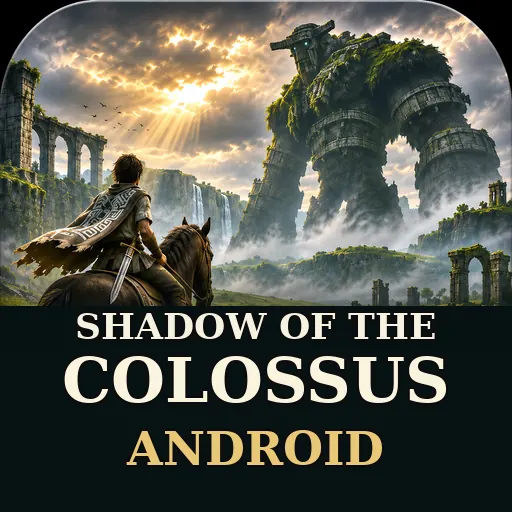

  

<h1 align="center">Shadow of the Colossus — Android</h1>

<strong>Daedalus · Native ARM64 AOT · Vulkan · Version 0.2.0</strong>

  <a href="README.md">Português (Brasil)</a> ·
  <a href="#installation">Installation</a> ·
  <a href="#features">Features</a> ·
  <a href="#source-and-builds">Source</a> ·
  <a href="CREDITS.md">Credits</a> ·
  <a href="https://github.com/erickmendes22/ShadowOfTheColossus-Android-Aot/issues">Issues</a>

An **experimental, unofficial Android port** maintained by **[erickmendes22 / Daedalus Emulator](https://www.youtube.com/@daedalusemulator)**, derived from **[AjncSystem's ShadowOfTheColossus-PC](https://github.com/AjncSystem/ShadowOfTheColossus-PC)** and other open-source projects.

> [!IMPORTANT]
> This repository **does not contain the game**, PKGs, Sony-owned game files, firmware, decrypted executables, or decryption keys. Use your own *Shadow of the Colossus* PS4 game copy. This project is not affiliated with Sony Interactive Entertainment or Bluepoint Games.

## Project status

| Component | Implementation |
| --- | --- |
| App version | **0.2.0** · `versionCode 20000` |
| Guest CPU execution | **Native ARM64 AOT**, no FEX and no TSO |
| Graphics | Vulkan, Android Bionic and AHardwareBuffer |
| Bundled driver | **GameHub DD 26.3 Turnip** only; SHA-256 verified |
| Launcher languages | Brazilian Portuguese and English |
| Status | Experimental — performance and compatibility vary by device and game files |

### Supported game editions

| Region | Title ID | Game version |
| --- | --- | --- |
| Europe | **CUSA08809** | **1.00** |
| United States | **CUSA08034** | **1.00** |

Executable patches use **strict hashes and original-byte checks**. A matching title ID does not mean that arbitrary modified or updated executables will work.

## Features

**Game execution and graphics**
- On-device **ARM64 AOT compilation**, required for the first launch.
- **Native audio:** built-in NGS2 mixer adapted from the upstream PC 0.75+ implementation (Oussama268 / HayatoG), outputting stereo 48 kHz PCM on Android without proprietary firmware audio modules. Actual device playback remains to be tested.
- Previously validated AOT profiles can be reused following app updates; changing game files, patches, or internal resolution may require another compilation.
- Internal rendering at **720p, 540p, or 360p** with 720p display output.
- Aspect-ratio preservation or optional screen fill.
- Optional **FPS + CPU + GPU**, FPS-only, or hidden HUD. CPU/GPU information depends on available device sensors.

**Launcher and input**
- Customizable on-screen controls, physical gamepad support, camera sensitivity, and layout editing.
- In-game menu: resolution/patches with AOT-verified restart; fullscreen and HUD can change without restarting.
- Base PKG extraction into an **automatically created subfolder**, or use an existing extracted game folder.
- Save data import/export and diagnostics log export.

## Installation

> [!NOTE]
> **No publicly signed APK Release is currently published in this GitHub repository.** [GitHub Actions](https://github.com/erickmendes22/ShadowOfTheColossus-Android-Aot/actions) provides development artifacts, but the workflow uploads **unsigned APKs**. These are not drop-in upgrades for an existing signed installation.

1. Use an APK **signed with the same certificate** as your installed version. To preserve saved data and compiled profiles, do not uninstall the existing app.
2. In the launcher, select your own extracted game folder containing `eboot.bin` and `sce_sys/param.sfo`, or use **Install PKG** to extract your own base package into a new subfolder.
3. Start the game and allow the first on-device ARM64 AOT compilation.
4. Later launches verify and reuse compatible compiled profiles. Patch and resolution changes apply after an AOT-verified restart.

**Current requirements:** ARM64 Android device with Adreno graphics and Vulkan support. Validation of the bundled GameHub Turnip driver currently requires **Android 14 (API 34) or newer**. Other GPUs, drivers, and older Android versions have not been confirmed for this build.

## In-game settings

| Setting | When it takes effect |
| --- | --- |
| Internal resolution | Game restart with AOT profile validation/recompilation if required |
| Executable patches | Game restart with AOT profile validation/recompilation if required |
| Fill screen / preserve aspect ratio | **Immediately**, without restart |
| FPS / CPU / GPU HUD | **Immediately**, without restart |

**Save first:** restarting discards unsaved game progress.

## Does the Android APK use FEX?

**No.** The 0.2.0 APK has been inspected: its runtime manifest declares `fex_runtime_included: false`, and the packaged runtime does not include FEX dynamic translation binaries. The current game CPU path runs **natively compiled ARM64 AOT without TSO**.

Some Java package names, upstream source files, and license notices still refer to the earlier `fexdroid`-derived infrastructure or historical FEX experiments. These **are not evidence that FEX runs the game**. Required historical credit and license notices must remain intact.

## Source and builds

Key project directories and files:

- [Android launcher](android-launcher/)
- [SotC runtime, compiler and patches](ports/sotc/android/)
- [CPU](cpu/) and [GPU](gpu/) sources, including upstream components
- [Current 0.2.0 APK workflow](.github/workflows/sotc-021-apk.yml)
- [Required validation and release rules](AGENTS.md)

The Android runtime requires an ARM64 host/renderer **ABI check** using [`verify_sotc_link.py`](ports/sotc/android/verify_sotc_link.py), including binaries extracted from the final payload. Successful compilation alone does not prove the game works on a device. **Private APK signing keys are not stored in this public repository.**

## Credits and licenses

This port is **derivative work**. The Android-specific adaptation is maintained by **erickmendes22**, building on:

| Project / authors | Contribution |
| --- | --- |
| [AjncSystem / ShadowOfTheColossus-PC](https://github.com/AjncSystem/ShadowOfTheColossus-PC) | Original PC port and upstream contributors |
| [bloodborne_pc — Supermedo and contributors](https://github.com/Supermedo/bloodborne_pc) | Loader and underlying runtime infrastructure |
| [shadPS4](https://github.com/shadps4-emu/shadPS4) and [Pink-shadPS4](https://github.com/luizgustavs/Pink-shadPS4) | Vulkan renderer and graphics compatibility |
| [ducvd89 / Bloodborne-Android](https://github.com/ducvd89/Bloodborne-Android) | Android/AOT architecture and tooling references |
| [cobrabm12 / fexdroid](https://github.com/cobrabm12/fexdroid) | Historically inherited Android components; **not the active game CPU runtime** |
| [Mesa / Turnip](https://gitlab.freedesktop.org/mesa/mesa) and [Droid-Deck / Drivers](https://github.com/Droid-Deck/Drivers) | Vulkan driver technology and contributions |
| [WinlatorComponents](https://github.com/erickmendes22/WinlatorComponents) | GameHub DD driver distribution |
| [erickmendes22 / Daedalus](https://github.com/erickmendes22/ShadowOfTheColossus-Android-Aot) | Android adaptation, testing and maintenance |

See **[CREDITS.md](CREDITS.md)** for full attribution, [LICENSE](LICENSE) for the project's license, and [THIRD_PARTY_LICENSES.txt](android-launcher/app/src/main/assets/THIRD_PARTY_LICENSES.txt) for third-party notices. The derivative code is under **GPL-2.0-or-later** where applicable; other components retain their respective licenses.

---

  <a href="https://github.com/erickmendes22/ShadowOfTheColossus-Android-Aot/issues">Report a problem</a>
  · <a href="https://www.youtube.com/@daedalusemulator">YouTube @daedalusemulator</a>
  · <a href="README.md">Português</a>

