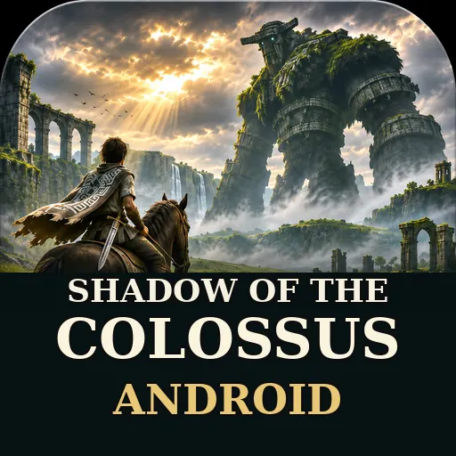

  

<h1 align="center">Shadow of the Colossus — Android</h1>

<strong>Daedalus · ARM64 AOT nativo · Vulkan · Versão 0.2.0</strong>

  <a href="README.en.md">English</a> ·
  <a href="#instalação">Instalação</a> ·
  <a href="#recursos">Recursos</a> ·
  <a href="#compilação-e-código-fonte">Código-fonte</a> ·
  <a href="CREDITS.md">Créditos</a> ·
  <a href="https://github.com/erickmendes22/ShadowOfTheColossus-Android-Aot/issues">Reportar problema</a>

Port **experimental e não oficial para Android**, mantido por **[erickmendes22 / Daedalus Emulator](https://www.youtube.com/@daedalusemulator)** e baseado no **[ShadowOfTheColossus-PC de AjncSystem](https://github.com/AjncSystem/ShadowOfTheColossus-PC)** e em diversos projetos abertos.

> [!IMPORTANT]
> O repositório **não distribui o jogo**, PKGs, arquivos proprietários, firmware nem chaves de descriptografia. Você precisa utilizar os arquivos de sua própria cópia de *Shadow of the Colossus* para PS4. Este port não é afiliado à Sony Interactive Entertainment ou à Bluepoint Games.

## Estado do projeto

| Item | Implementação |
| --- | --- |
| Versão do aplicativo | **0.2.0** · `versionCode 20000` |
| CPU do jogo | **ARM64 AOT nativo**, sem FEX e sem TSO |
| Gráficos | Vulkan, Bionic e AHardwareBuffer |
| Driver fornecido | **Turnip GameHub DD 26.3** — único driver integrado, validado por SHA-256 |
| Idiomas do launcher | Português (Brasil) e inglês |
| Situação | Experimental; funcionamento e desempenho dependem do aparelho e do jogo |

### Edições compatíveis

| Região | Title ID | Versão do jogo |
| --- | --- | --- |
| Europa | **CUSA08809** | **1.00** |
| Estados Unidos | **CUSA08034** | **1.00** |

Os patches exigem validação do executável original, inclusive **hash e bytes esperados**. O ID sozinho não garante suporte a outro `eboot.bin` ou atualização do jogo.

## Recursos

**Execução e desempenho**
- Compilação AOT **no próprio aparelho** na primeira utilização.
- **Áudio nativo:** mixer NGS2 embutido, adaptado do port de PC 0.75+ (Oussama268 / HayatoG), com mixagem de música e efeitos sem exigir módulos proprietários do firmware. A saída usa PCM estéreo 48 kHz no Android. A reprodução real depende de teste no aparelho.
- Cache de perfis AOT: compilações ainda válidas podem ser reutilizadas após atualizar o APK; alterações nos patches, na resolução ou no executável podem exigir nova compilação.
- Resolução interna **720p, 540p ou 360p**, com apresentação do jogo em 720p.
- Tela cheia opcional: proporção original ou preenchimento da tela.
- HUD configurável: **FPS + CPU + GPU**, somente FPS ou desativada. Os dados de CPU/GPU dependem dos medidores disponíveis no dispositivo.

**Launcher e controles**
- Controles virtuais editáveis, ajuste de tamanho e sensibilidade da câmera; compatibilidade com controle físico.
- Menu durante o jogo: resolução e patches com reinício e validação AOT; tela cheia e HUD sem reinício.
- PKG base instalado em **subpasta criada automaticamente**; também é possível selecionar uma pasta do jogo extraída.
- Exportação/importação de dados salvos e exportação de logs.

## Instalação

> [!NOTE]
> **Ainda não há um Release público do APK assinado neste repositório.** A página [GitHub Actions](https://github.com/erickmendes22/ShadowOfTheColossus-Android-Aot/actions) contém builds de desenvolvimento; os artefatos publicados pelo workflow são **não assinados** e não devem ser confundidos com um APK pronto para atualizar uma instalação existente.

1. Utilize um APK **assinado com o mesmo certificado** do aplicativo que já está instalado. Ao atualizar, não desinstale o aplicativo: isso pode apagar saves e caches.
2. Abra o launcher e selecione a pasta da sua cópia do jogo, contendo `eboot.bin` e `sce_sys/param.sfo`. Alternativamente, use a opção **Instalar PKG** para extrair seu PKG base em uma nova subpasta.
3. Inicie o jogo. Na primeira execução, o launcher prepara os arquivos e realiza a compilação **ARM64 AOT**.
4. Em execuções posteriores, a compilação existente é verificada antes de ser reutilizada. Mudanças de patches e resolução são aplicadas após reiniciar o jogo e validar o perfil correspondente.

**Requisitos atuais:** dispositivo Android **ARM64** com GPU Adreno e suporte a Vulkan. A validação da Turnip GameHub integrada no launcher exige **Android 14 (API 34) ou superior**. Outros drivers/GPU e versões anteriores do Android não têm suporte confirmado neste pacote.

## Configurações durante o jogo

| Ajuste | Quando entra em vigor |
| --- | --- |
| Resolução interna | Reinicia o jogo; valida ou recompila o AOT se necessário |
| Patches do jogo | Reinicia o jogo; valida ou recompila o AOT se necessário |
| Tela cheia / manter proporção | **Imediatamente**, sem reiniciar |
| HUD de FPS, CPU e GPU | **Imediatamente**, sem reiniciar |

**Salvar antes de reiniciar:** o progresso ainda não salvo no jogo será perdido.

## Por que há referências a FEX no código?

**O jogo não é executado pelo FEX.** O APK Android 0.2.0 foi conferido: seu manifesto declara `fex_runtime_included: false` e o pacote não contém o executável nem o runtime de tradução dinâmica FEX. O caminho ativo do jogo utiliza **AOT ARM64 nativo, sem TSO**.

Alguns **nomes de pacote e fontes herdadas** ainda fazem referência a `fexdroid` ou à implementação FEX utilizada em estágios anteriores ou no código de origem. Isso não significa que o FEX execute o jogo. Arquivos de licença e créditos históricos precisam ser preservados por respeito à autoria e às licenças. O código legado do repositório não deve ser confundido com os componentes incluídos no APK.

## Compilação e código-fonte

O desenvolvimento do Android está principalmente em:

- [Launcher Android](android-launcher/)
- [Runtime, compilador e patches do SotC](ports/sotc/android/)
- [CPU](cpu/) e [GPU](gpu/) herdadas e adaptadas do upstream
- [Workflow de compilação do APK 0.2.0](.github/workflows/sotc-021-apk.yml)
- [Critérios obrigatórios de build e verificação](AGENTS.md)

A distribuição do runtime depende da checagem **ABI ARM64** dos binários finais por [`verify_sotc_link.py`](ports/sotc/android/verify_sotc_link.py). Builds nativos e testes estáticos não substituem testes de execução em aparelho. **A chave privada usada para assinar o APK não está no repositório.**

## Créditos e licenças

Este é um **trabalho derivado**. A adaptação Android é de **erickmendes22**, mas o projeto depende das contribuições dos autores e comunidades abaixo:

| Projeto / autores | Contribuição |
| --- | --- |
| [AjncSystem / ShadowOfTheColossus-PC](https://github.com/AjncSystem/ShadowOfTheColossus-PC) | Port original para PC e colaboradores |
| [bloodborne_pc — Supermedo e colaboradores](https://github.com/Supermedo/bloodborne_pc) | Carregador e infraestrutura inicial |
| [shadPS4](https://github.com/shadps4-emu/shadPS4) e [Pink-shadPS4](https://github.com/luizgustavs/Pink-shadPS4) | Renderização e compatibilidade Vulkan |
| [ducvd89 / Bloodborne-Android](https://github.com/ducvd89/Bloodborne-Android) | Referências e ferramentas de infraestrutura Android/AOT |
| [cobrabm12 / fexdroid](https://github.com/cobrabm12/fexdroid) | Base histórica de componentes Android; **não é o CPU runtime do jogo** |
| [Mesa / Turnip](https://gitlab.freedesktop.org/mesa/mesa) e [Droid-Deck / Drivers](https://github.com/Droid-Deck/Drivers) | Driver Vulkan e contribuições |
| [WinlatorComponents](https://github.com/erickmendes22/WinlatorComponents) | Distribuição do driver GameHub DD |
| [erickmendes22 / Daedalus](https://github.com/erickmendes22/ShadowOfTheColossus-Android-Aot) | Adaptação, testes, launcher e manutenção Android |

Confira **[CREDITS.md](CREDITS.md)** para as atribuições completas, [LICENSE](LICENSE) para a licença principal e [THIRD_PARTY_LICENSES.txt](android-launcher/app/src/main/assets/THIRD_PARTY_LICENSES.txt) para avisos de terceiros. O código derivado é distribuído sob **GPL-2.0-or-later**, quando aplicável. *Shadow of the Colossus* pertence aos seus respectivos titulares.

---

  <a href="https://github.com/erickmendes22/ShadowOfTheColossus-Android-Aot/issues">Problemas e sugestões</a>
  · <a href="https://www.youtube.com/@daedalusemulator">YouTube @daedalusemulator</a>
  · <a href="README.en.md">English</a>

